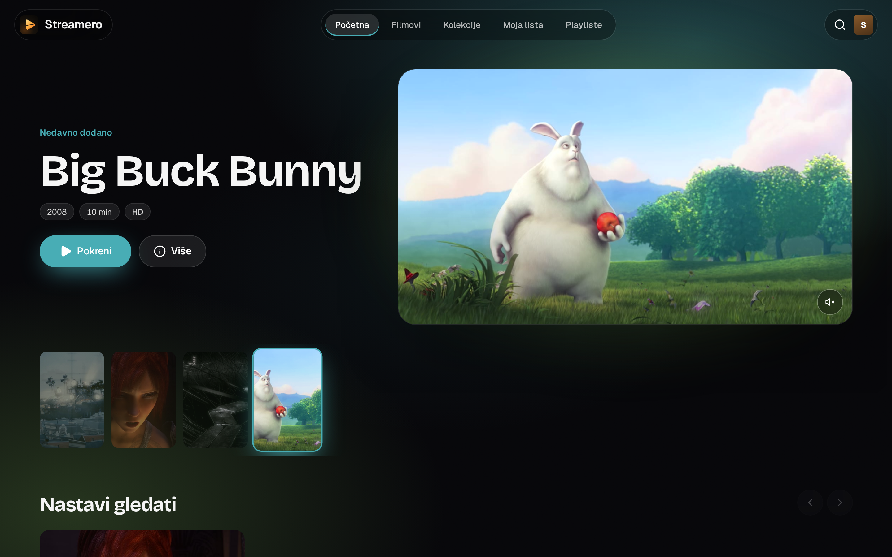
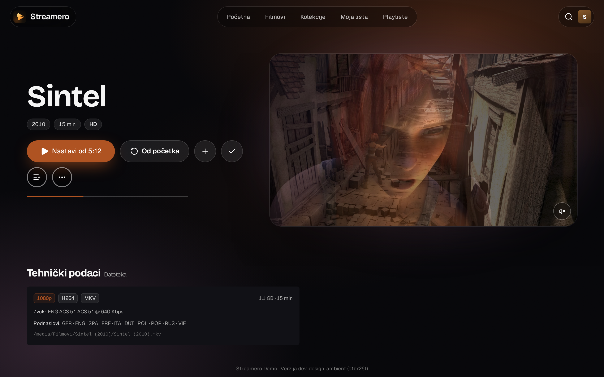
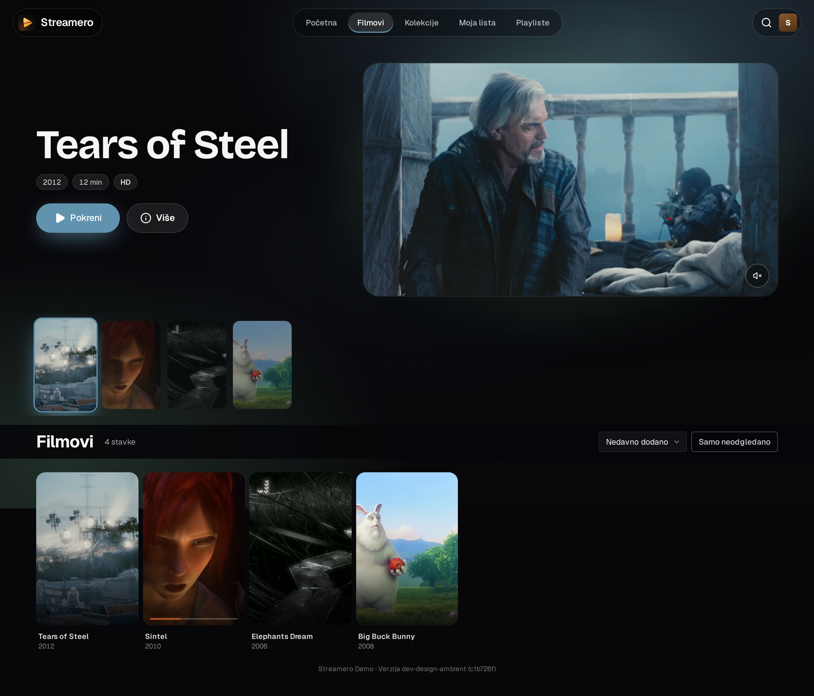
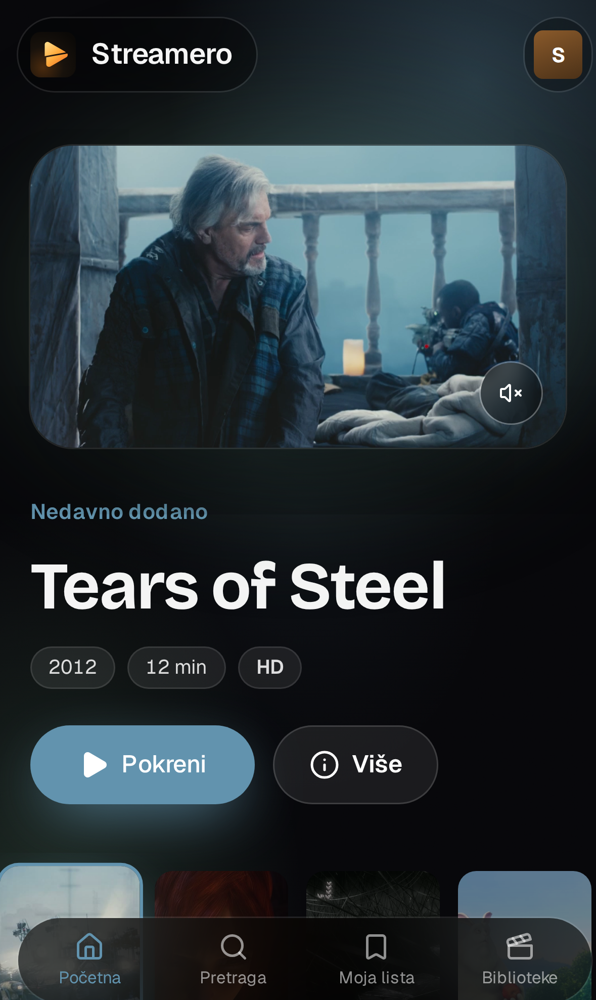
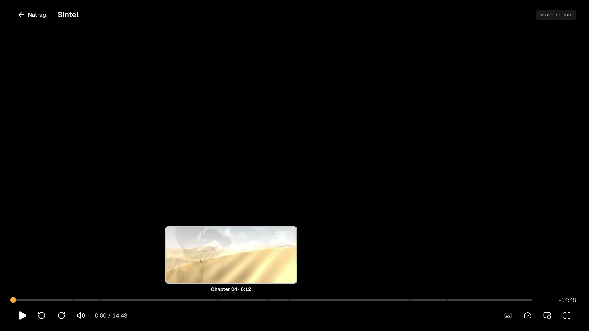

# Screenshots — Ambient

Streamero's own look: the room is lit by the title in focus. The background, glow and Play button take the colours of the film (extracted from its artwork). The home *stage* shows the title next to its lit *screen*, with a muted preview inside.

Demo content: Blender Foundation open movies (© Blender Foundation, CC BY). No TMDb key on the demo, so the artwork is frames from the films.

**Player** (trickplay + chapters on the seek bar)

**Administration**

