# Screenshots

Demo content: Blender Foundation open movies (Sintel, Tears of Steel, Elephants Dream, Big Buck Bunny; © Blender Foundation, CC BY). The demo has no TMDb key, so the artwork is Streamero's own frame grabs; with a key, posters, title logos and cast photos replace them.

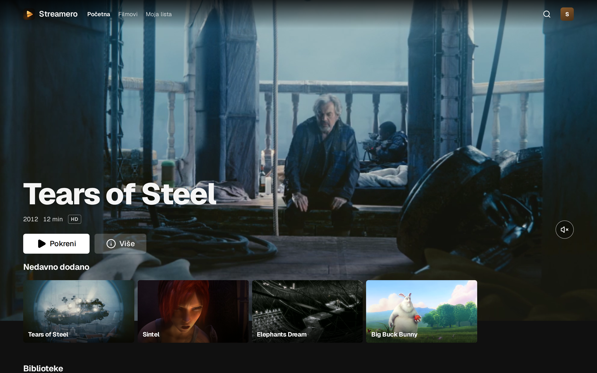

**Desktop**

| | |
|---|---|
| 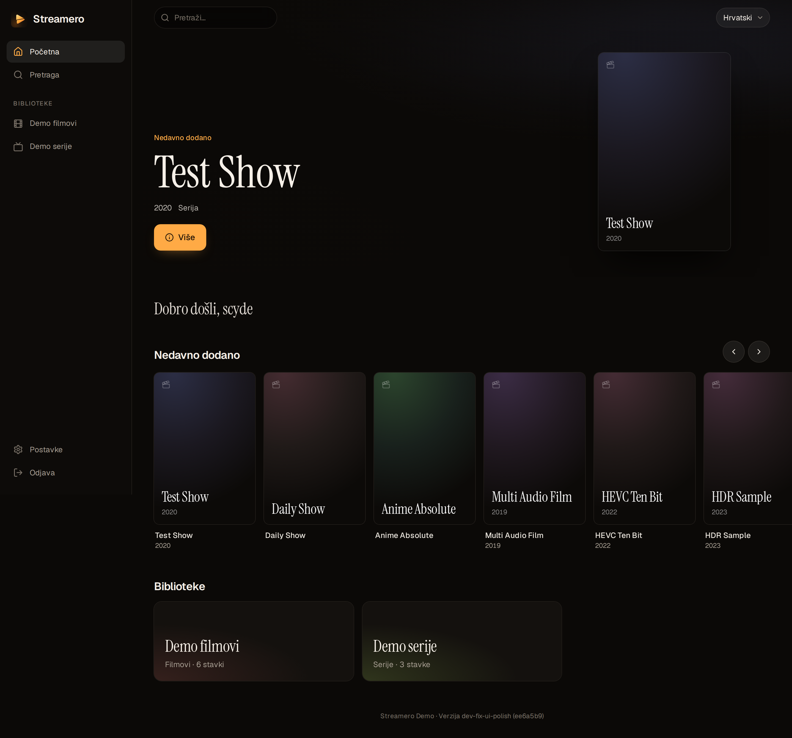 | 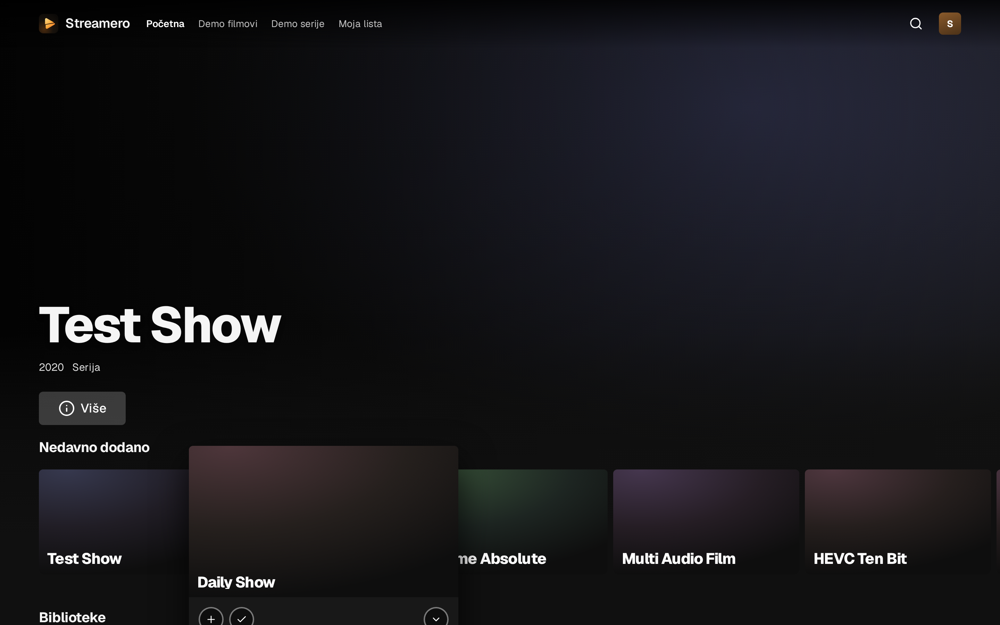 |
| 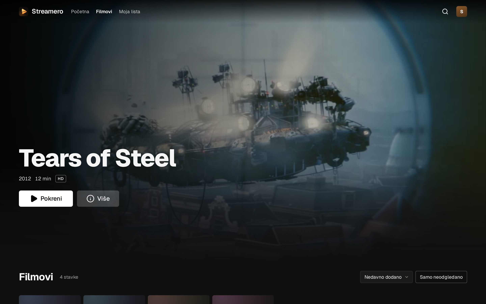 | 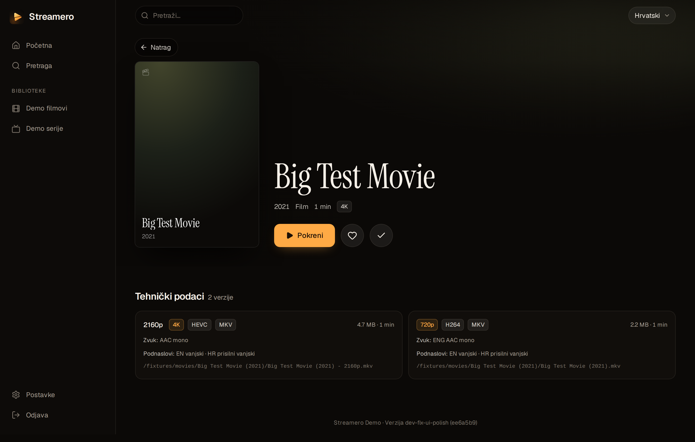 |
| 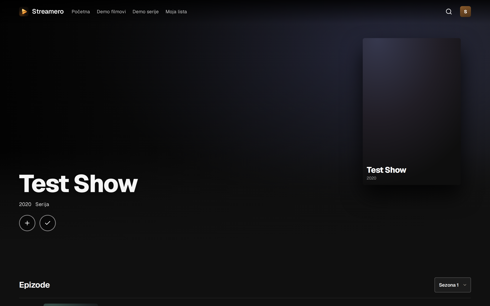 | 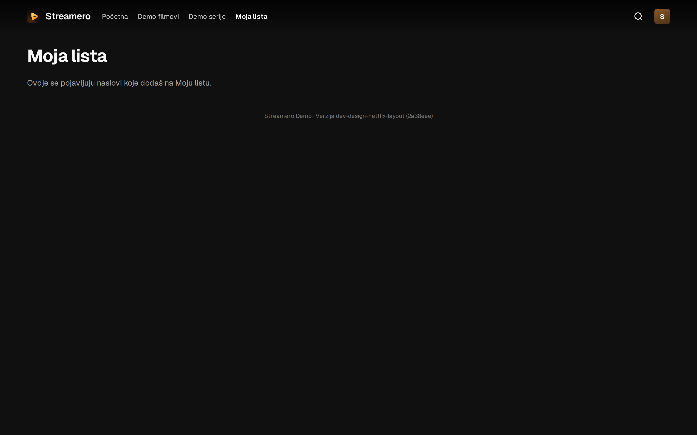 |

**TV (1920×1080, remote focus)**

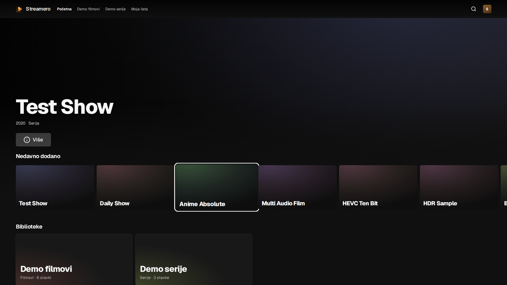

**Phone**

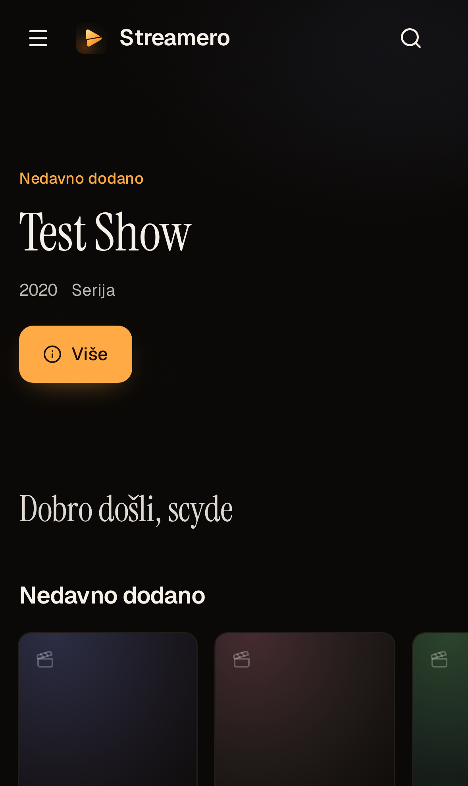 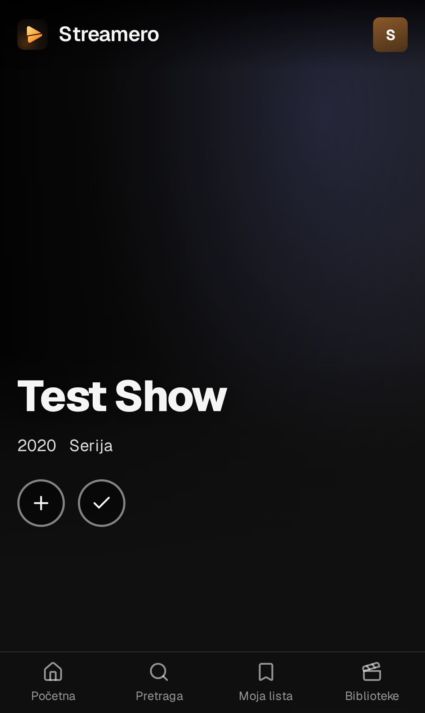 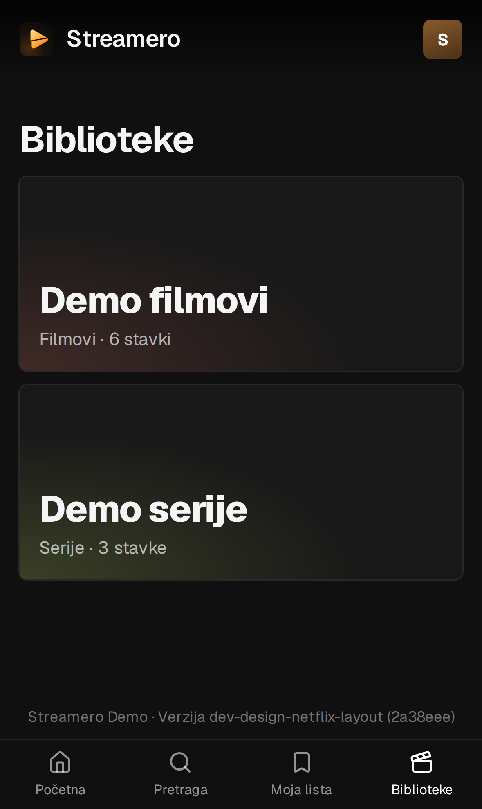

**App icon**

**Administration**

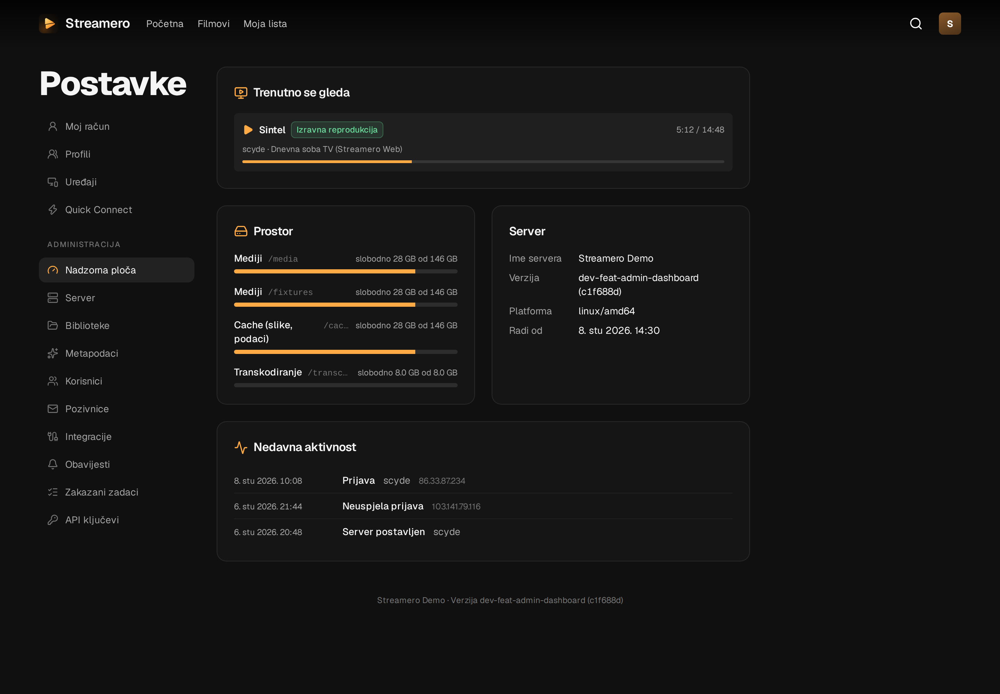
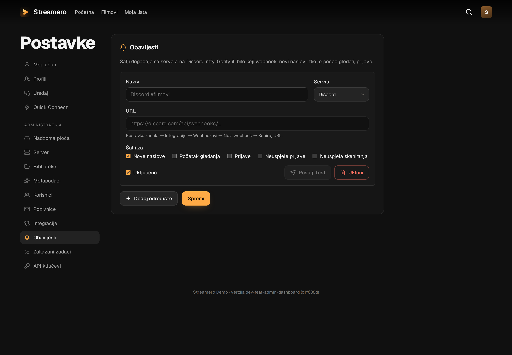
